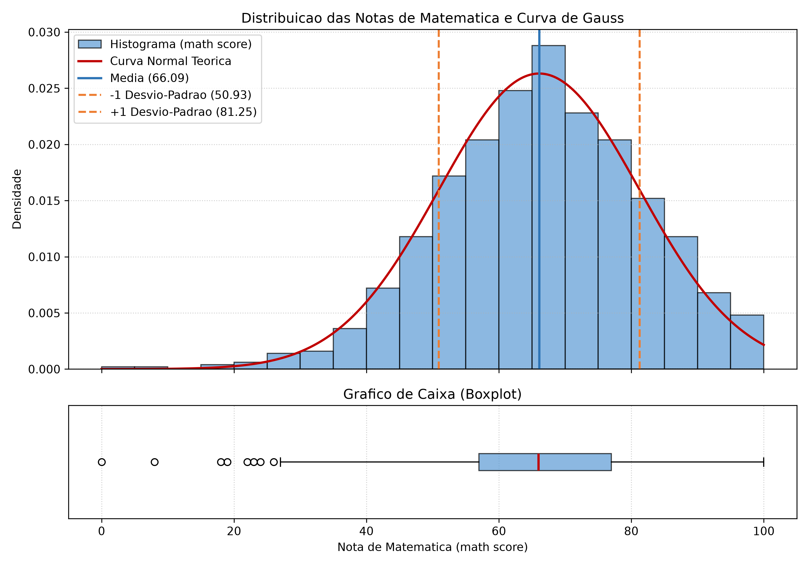

# Distribuição Normal e Curva de Gauss

Trabalho da disciplina de **Probabilidade e Estatística Aplicada**. O programa lê as notas do arquivo `StudentsPerformance.csv`, calcula as medidas estatísticas direto no Python (sem usar bibliotecas prontas de estatística), testa a regra 68-95-99,7, calcula o escore $z$ e gera o gráfico com o histograma e a Curva de Gauss.

## Autores

<table>
  <tr>
    <td align="center">
      <a href="https://github.com/Ramos902">
        <br />
        <sub><b>João Pedro Ramos</b></sub>
      </a><br />
      <sub><a href="https://github.com/Ramos902">@Ramos902</a></sub>
    </td>
    <td align="center">
      <br />
      <sub><b>Gabriel Leme</b></sub>
    </td>
  </tr>
</table>

## Sobre a Base de Dados

Foi usada a base [Students Performance in Exams](https://www.kaggle.com/datasets/spscientist/students-performance-in-exams) (`StudentsPerformance.csv`), que tem 1000 linhas e 8 colunas. A análise principal do trabalho foi feita em cima da coluna `math score` (notas de matemática).

Conforme pedido na atividade, os cálculos não usam `statistics`, `scipy`, `numpy` nem `pandas`. Foram usados apenas os módulos `csv`, `math` e `matplotlib`.

## Arquivos do Projeto

- `analise_distribuicao_normal.py`: código em Python com os cálculos e geração do gráfico.
- `StudentsPerformance.csv`: base de dados com as 1000 notas.
- `histograma_curva_normal.png`: imagem gerada com o histograma, curva normal e boxplot.
- `relatorio.pdf` e `relatorio.md`: relatório com a parte teórica, resultados e respostas da conclusão.

## Fórmulas Usadas

- **Função densidade da distribuição normal:**
  $$f(x) = \frac{1}{\sigma\sqrt{2\pi}} e^{-\frac{(x - \mu)^2}{2\sigma^2}}$$

- **Desvio-padrão amostral:**
  $$s = \sqrt{\frac{\sum_{i=1}^{n} (x_i - \bar{x})^2}{n - 1}}$$

- **Escore padronizado $z$:**
  $$z = \frac{x - \bar{x}}{s}$$

## Resultados Principais (`math score`)

### Parte B - Leitura dos dados
- Total de registros carregados: 1000
- Valores ausentes ou inválidos: 0

### Parte C - Medidas estatísticas
- Quantidade de dados: 1000
- Menor nota: 0
- Maior nota: 100
- Amplitude total: 100
- Média aritmética ($\bar{x}$): 66,0890
- Mediana: 66,00
- Moda: 65 (aparece 36 vezes)
- Variância amostral ($s^2$): 229,9190
- Desvio-padrão amostral ($s$): 15,1631
- Coeficiente de assimetria: -0,2789

### Parte D - Regra 68-95-99,7
- Entre $\bar{x} - s$ e $\bar{x} + s$ (50,93 a 81,25): **696 notas (69,60%)** - esperado: ~68%
- Entre $\bar{x} - 2s$ e $\bar{x} + 2s$ (35,76 a 96,42): **954 notas (95,40%)** - esperado: ~95%
- Entre $\bar{x} - 3s$ e $\bar{x} + 3s$ (20,60 a 111,58): **996 notas (99,60%)** - esperado: ~99,7%

### Parte E - Escores $z$
- Menor nota (0): $z = -4,3585$ (Atípico, $|z| > 3$)
- Maior nota (100): $z = 2,2364$ (Normal)
- Nota 50: $z = -1,0611$ (Normal)
- Nota 75: $z = 0,5877$ (Normal)
- Nota 90: $z = 1,5769$ (Normal)
- Notas atípicas ($|z| > 3$) em toda a tabela: 4 notas (0, 8, 18 e 19).

## Gráfico Gerado (Parte F)



## Como Rodar

Instale o `matplotlib` caso não tenha:
```bash
pip install matplotlib
```

Rode o arquivo principal:
```bash
python3 analise_distribuicao_normal.py
```
